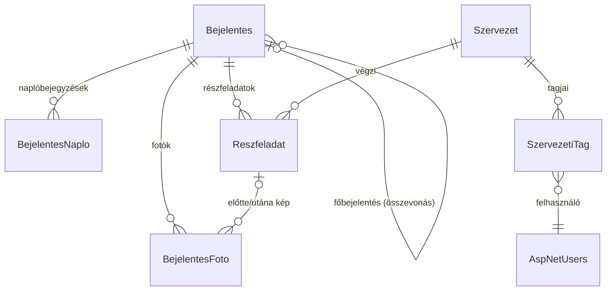

# Adatmodell

A modell az `OnkormanyzatiPortal/Models` mappa osztályain és az `ApplicationDbContext` beállításain alapul. A belépést az ASP.NET Core Identity saját táblái kezelik (`AspNetUsers`, `AspNetRoles`, `AspNetUserRoles` stb.), ezeket itt nem soroljuk fel.

## Kapcsolatok

## Bejelentes

| Mező | Típus | Szabály |
|---|---|---|
| Id | int | kulcs |
| Cim | string | kötelező, legfeljebb 120 karakter |
| Leiras | string | kötelező, legfeljebb 2000 karakter |
| Helyszin | string | kötelező, legfeljebb 200 karakter |
| LetrehozvaUtc | DateTime | UTC beérkezés |
| Kategoria | BejelentesKategoria | alapérték: Egyeb |
| Allapot | BejelentesAllapot | alapérték: Uj |
| Hatarido | DateTime? | az ellenőrzéskor kerül kitöltésre |
| Verzio | Guid | párhuzamos módosítás ellenőrzése (`ConcurrencyCheck`) |
| LezarvaUtc | DateTime? | sikeres lezárás ideje |
| Kovetokod | Guid? | egyedi (szűrt index), a lakossági követéshez |
| Ertekeles | int? | lakossági értékelés, lezárt ügyre |
| Szelesseg, Hosszusag | double? | térképes hely |
| Veszelyes | bool | veszélyes ügy jelölése |
| FoBejelentesId | int? | összevonáskor a főbejelentésre mutat |

## BejelentesNaplo

| Mező | Típus | Szabály |
|---|---|---|
| Id | int | kulcs |
| BejelentesId | int | a bejelentés hivatkozása |
| Muvelet | string | legfeljebb 100 karakter |
| ElozoAllapot | BejelentesAllapot? | a váltás előtti állapot |
| UjAllapot | BejelentesAllapot | a váltás utáni állapot |
| Hatarido | DateTime? | a naplózáskor érvényes határidő |
| IdopontUtc | DateTime | UTC időpont |
| FelhasznaloId | string? | a műveletet végző Identity-felhasználó |

## Szervezet

| Mező | Típus | Szabály |
|---|---|---|
| Id | int | kulcs |
| Nev | string | kötelező, legfeljebb 100 karakter |

Kezdeti adat: Útfenntartás, Köztisztaság, Közvilágítás.

## SzervezetiTag

| Mező | Típus | Szabály |
|---|---|---|
| FelhasznaloId | string | kulcs, egy Identity-felhasználó egy szervezethez tartozhat |
| SzervezetId | int | a szervezet hivatkozása |

## Reszfeladat

| Mező | Típus | Szabály |
|---|---|---|
| Id | int | kulcs |
| BejelentesId | int | a főügy hivatkozása |
| SzervezetId | int | a végző szervezet |
| Cim | string | kötelező, legfeljebb 160 karakter |
| Hatarido | DateTime | nem lehet későbbi az ügy határidejénél |
| Elkeszult | bool | készre jelentés |
| Megjegyzes | string? | helyszíni megjegyzés, legfeljebb 1000 karakter |

## BejelentesFoto

| Mező | Típus | Szabály |
|---|---|---|
| Id | int | kulcs |
| BejelentesId | int | a bejelentés hivatkozása |
| ReszfeladatId | int? | csak az Elotte és Utana típusnál |
| Tipus | BejelentesFotoTipus | Bejelentes, Elotte, Utana |
| TartalomTipus | string | image/jpeg vagy image/png |
| Tartalom | byte[] | a kép adata, legfeljebb 5 MB, JPEG vagy PNG |

## Felsorolások

| BejelentesKategoria | BejelentesAllapot |
|---|---|
| Egyeb, Uthiba, Kozvilagitas, Hulladek, Utcabutor, Forgalomtechnika, Parkok, ElhagyottJarmu, Kozmu | Uj, Ellenorizve, Folyamatban, LezarasraVar, Lezart, Teves, HataskoronKivuli, Osszevont |

## Állapotváltások

| Honnan | Hová | Ki és mikor |
|---|---|---|
| Uj, Ellenorizve | Ellenorizve | Ügyintéző ellenőrzi az ügyet, pontosítja az adatait és határidőt ad (ma vagy később) |
| Ellenorizve, Folyamatban | Folyamatban | Ügyintéző részfeladatot ad egy szervezetnek (a határidő nem lehet későbbi az ügyénél) |
| Folyamatban | LezarasraVar | Végrehajtó készre jelenti az utolsó nyitott részfeladatot |
| LezarasraVar | Lezart | Ügyintéző lezárja, ha van részfeladat és mind elkészült |
| Uj, Ellenorizve | Teves, HataskoronKivuli | Ügyintéző, indoklással (legfeljebb 80 karakter) |
| Ellenorizve, Folyamatban, LezarasraVar | Osszevont | Ügyintéző egy azonos kategóriájú főbejelentéshez kapcsolja |

## Korlátok és védelem

- A `Kovetokod` egyedi, ahol van értéke. Egyszerű, véletlen `Guid`, nem aláírt és nem lejáró token: aki ismeri, látja az ügy állapotát és határidejét. Éles rendszerben ezt erősebb megoldásra kellene cserélni.
- A `Verzio` minden módosításkor új értéket kap; elavult módosítás nem menthető el.
- A fotó fogadásakor a fájl tartalma is ellenőrzésre kerül, nem csak a kiterjesztés.
- Törlő felület nincs, ügy és napló nem törölhető az alkalmazásból.
- A bejelentő neve és e-mail-címe nem tárolódik.
